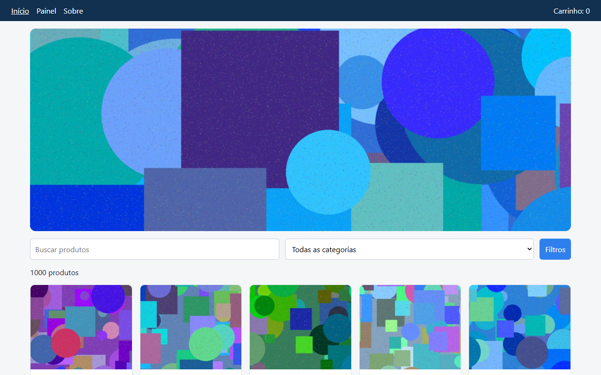
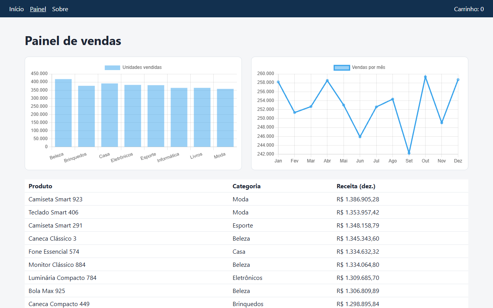
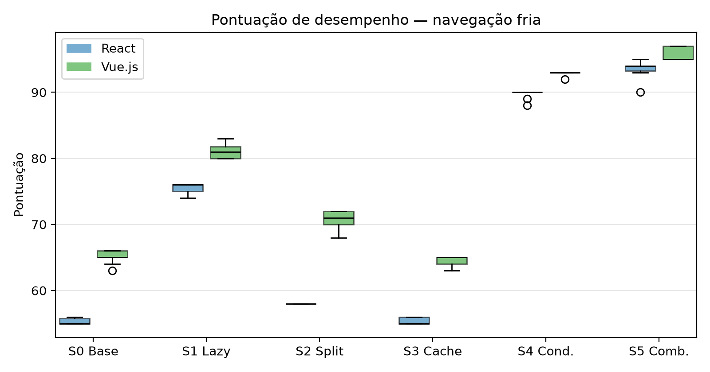

<div align="center">

<picture>
  <source media="(prefers-color-scheme: dark)" srcset="docs/ifmt-logo-dark.svg">
  
</picture>

# Otimização de desempenho web: React x Vue.js

**Experimento do Trabalho de Conclusão de Curso**<br>
Tecnologia em Sistemas para Internet · Instituto Federal de Mato Grosso (IFMT) · 2026


</div>

---

## Sobre o trabalho

Este repositório reúne o código, os dados e os scripts do experimento do TCC

> **Análise comparativa de estratégias de otimização de desempenho em aplicações web desenvolvidas com frameworks JavaScript modernos: um estudo com React e Vue.js**

| | |
|---|---|
| **Autor** | Carlos Manoel de Barros Tavares |
| **Orientador** | Prof. Ubirajara Martin Coelho |
| **Curso** | Tecnologia em Sistemas para Internet (EaD / UAB) |
| **Instituição** | Instituto Federal de Educação, Ciência e Tecnologia de Mato Grosso |
| **Local e ano** | Sapezal – MT, 2026 |

**Pergunta de pesquisa:** como lazy loading, code splitting, caching e renderização condicional afetam o desempenho de uma aplicação feita em React e da mesma aplicação feita em Vue.js?

Tudo aqui está publicado para que qualquer pessoa possa conferir os números do trabalho ou repetir o experimento.

## A aplicação

A mesma loja de demonstração foi feita duas vezes, uma em cada framework, com as mesmas telas, o mesmo CSS e os mesmos dados:

- catálogo com **1.000 produtos** e imagens;
- busca por texto e painel de filtros;
- página de detalhe do produto;
- painel com gráficos (Chart.js).

<p align="center">
  
  
</p>

## Cenários testados

Cada aplicação foi compilada em 6 versões, uma para cada técnica, totalizando 12 builds:

| Cenário | Técnica aplicada | Como foi feito |
|---|---|---|
| **S0** | Nenhuma (linha de base) | Versão sem otimização |
| **S1** | Lazy loading | `loading="lazy"` nas imagens |
| **S2** | Code splitting | Divisão por rota (`React.lazy` / rotas assíncronas do Vue Router) |
| **S3** | Caching | Service worker (Workbox) e cabeçalhos de cache HTTP |
| **S4** | Renderização condicional | Lista virtualizada e painel de filtros montado só quando aberto |
| **S5** | Todas juntas | S1 + S2 + S3 + S4 |

## Como foi medido

- **Ferramenta:** Lighthouse 13.6 no modo *user flow*, com Chrome em modo headless e perfil móvel padrão.
- **Três etapas por execução:**
  1. **Navegação fria:** primeira visita, sem cache (throttling simulado);
  2. **Navegação quente:** segunda visita, com cache (throttling aplicado);
  3. **Interação:** digitar na busca, abrir e fechar os filtros, abrir um produto.
- **Métricas:** pontuação de desempenho, LCP, INP, CLS, TBT, FCP, Speed Index, bytes transferidos, número de requisições e nós do DOM.
- **Repetições:** 10 execuções × 12 builds × 3 etapas = **360 medições**.
- **Estatística:** mediana e intervalo interquartil, variação em relação ao S0 e teste de Mann-Whitney (bilateral, p < 0,05).

## Principais resultados

Pontuação de desempenho (0 a 100) na **primeira visita**, mediana de 10 execuções:

| Cenário | React | Vue.js |
|---|:---:|:---:|
| S0 Sem otimização | 55 | 65 |
| S1 Lazy loading | 76 | 81 |
| S2 Code splitting | 58 | 71 |
| S3 Caching | 55 | 65 |
| S4 Renderização condicional | 90 | 93 |
| **S5 Todas juntas** | **94** | **95** |

<p align="center">
  
</p>

O que os dados mostram:

- **Sem otimização, o Vue.js foi melhor.** A nota foi 65 contra 55, o TBT foi quatro vezes menor e o INP ficou na metade.
- **Com todas as técnicas, a diferença quase some** (94 x 95). Na segunda visita, os dois chegam a 100.
- **Lazy loading e renderização condicional deram os maiores ganhos.** Os dois cortaram cerca de 98% dos dados baixados.
- **Code splitting ajudou pouco nesta aplicação.** O pacote inicial diminuiu (React de 455 KB para 253 KB, Vue.js de 294 KB para 91 KB), mas o peso da página está quase todo nas imagens.
- **O caching só aparece na segunda visita.** Nela, o S3 transfere 0 KB e o FCP cai cerca de 77%.

Conclusão: **as técnicas usadas pesaram mais no resultado do que a escolha do framework.** Os detalhes e a discussão estão na monografia.

## Estrutura do repositório

```
├── react-app/        aplicação em React (TypeScript + Vite)
├── vue-app/          aplicação em Vue.js (TypeScript + Vite)
├── shared/           CSS comum e gerador de dados/imagens (semente fixa)
├── scripts/          build, teste funcional, medição, análise e capturas
├── results/
│   ├── medicoes.csv      todas as 360 medições
│   ├── resumo.csv        mediana, IQR, variação e p-valor
│   ├── react_vs_vue.csv  comparação direta entre os frameworks
│   ├── tabelas.md        tabelas usadas na monografia
│   ├── bundles.csv       tamanho dos pacotes JavaScript
│   ├── graficos/         gráficos (boxplots e barras)
│   ├── capturas/         capturas de tela das aplicações
│   ├── raw/              saída do Lighthouse de cada execução
│   └── piloto/           medições do teste piloto
└── docs/             imagens do README
```

## Como reproduzir

**Requisitos:** Node.js 20 ou mais recente e Python 3.10 ou mais recente (com `pillow`, `pandas`, `scipy` e `matplotlib`).

```bash
# 1. Dependências (na raiz, em react-app/ e em vue-app/)
npm install
npx @puppeteer/browsers install chrome@stable --path .chrome

# 2. Dados e imagens da loja (semente fixa, sempre iguais)
python -I shared/generate-data.py shared/public

# 3. Gerar os 12 builds e conferir que funcionam
node scripts/build-all.mjs
node scripts/smoke-test.mjs

# 4. Medir (10 rodadas, cerca de 3 horas)
node scripts/measure.mjs 10

# 5. Gerar tabelas, gráficos e testes estatísticos
python -I scripts/analyze.py
```

> Os números absolutos mudam de um computador para outro. As comparações entre cenários e entre frameworks devem se manter.

## Observações

- Na segunda visita, os cenários S0 e S2 ficaram sem pontuação e sem TBT. A página baixa cerca de 18 MB de imagens e não termina de carregar dentro do limite de 120 segundos do Lighthouse (aviso `NO_TTI_NETWORK_IDLE_PERIOD`, confirmado com `scripts/diag-quente.mjs`). As métricas FCP, LCP e Speed Index desses cenários continuam válidas.
- Todas as medições foram feitas em um único computador, com rede e processador emulados. Os resultados não representam usuários reais.

## Como citar

> TAVARES, Carlos Manoel de Barros. **Análise comparativa de estratégias de otimização de desempenho em aplicações web desenvolvidas com frameworks JavaScript modernos:** um estudo com React e Vue.js. 2026. Trabalho de Conclusão de Curso (Tecnologia em Sistemas para Internet) – Instituto Federal de Educação, Ciência e Tecnologia de Mato Grosso, Sapezal, 2026.

---

<div align="center">
<sub>Trabalho acadêmico desenvolvido no IFMT · 2026</sub>
</div>
